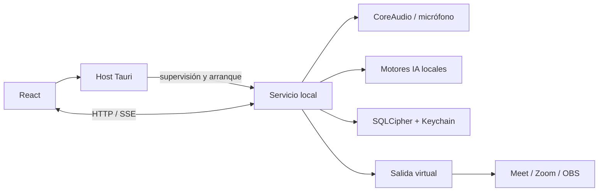

# Arquitectura

## Dos ediciones, prioridad Local

Local y Cloud serán dos productos de escritorio distintos, con contratos y módulos reutilizables. Esta etapa desarrolla únicamente Local. No se duplicará hoy el scaffold ni se desplegarán servidores.

La edición Local utiliza un ejecutable con dos modos y dos procesos: frontend Tauri + React y servicio hijo local. El servicio será un proceso hijo empaquetado con la aplicación, no un daemon permanente ni un servicio al iniciar sesión. El backend de Tauri actúa como supervisor y adaptador de IPC; la lógica de audio y persistencia vive en el servicio.

## Ciclo de vida

1. Al abrir la app, el host obtiene un bloqueo por usuario para evitar instancias duplicadas y arranca el servicio hijo.
2. El servicio verifica versión de protocolo, permisos, configuración, estado de modelos y base; responde `Ready` o un error recuperable. Arrancar el servicio no autoriza capturar audio sin permiso.
3. Ocultar el panel mantiene la aplicación abierta en la barra; no termina el servicio. Salir explícitamente detiene captura, vacía/cancela trabajos, cierra base e IPC y termina el hijo.
4. El canal padre-hijo y un heartbeat permiten detectar la muerte del host. Ante pérdida del supervisor, el servicio libera el audio y sale; no basta confiar solo en señales de cierre normales.
5. Ante fallo del servicio, la UI informa y permite reinicio controlado. Nunca deriva silenciosamente a micrófono físico sin filtros. El reinicio no cambia la entrada seleccionada por otras aplicaciones.

## Monolito modular y límites

El núcleo del servicio es un monolito modular. Tener dos procesos locales no implica separar cada módulo en un servidor. Cada módulo separa dominio, aplicación y adaptadores donde exista responsabilidad real; no se crean capas vacías. Cada IA tiene un módulo de integración propio. El frontend replica las capacidades necesarias con interfaces TypeScript y adaptadores HTTP/SSE.

| Módulo                       | Dueño de                                                                   |
| ---------------------------- | -------------------------------------------------------------------------- |
| `profiles`                   | Perfiles de ajustes y selección activa; no usuarios ni autenticación.      |
| `microphone`                 | Entradas físicas, capacidades, captura y mute del flujo controlado.        |
| `audio-pipeline`             | Sesión, buffers, resampling y composición de procesadores.                 |
| `noise-suppression`          | Contrato de reducción de ruido.                                            |
| `personal-voice`             | Registro y selección del perfil de voz, decisión de paso.                  |
| `ai-rnnoise`, `ai-nomo-pvad` | Adaptadores candidatos; se crean solo si son elegidos.                     |
| `model-manager`              | Manifiestos, versiones, descarga, verificación, instalación y eliminación. |
| `virtual-audio`              | Escritura al dispositivo virtual elegido.                                  |
| `desktop-shell`              | Panel, barra, atajos y supervisión del proceso.                            |

`commons` contiene contratos de eventos, registro/configuración de módulos, puertos de saga y errores comunes. No contiene entidades de negocio ni referencias a implementaciones. Cada módulo mantiene las opciones que necesita; `bootstrap` conecta implementaciones por constructor/factoría. En Rust se usan traits y, cuando se necesite, `Arc`; en React se inyectan casos de uso/puertos, con Context solo como distribución de instancias ya compuestas.

## Comunicación

Eventos de dominio privados dentro de cada módulo; eventos internos tipados para comunicar hechos entre módulos. Envelope actual: `eventId`, `eventType`, `schemaVersion`, `operationId` como correlación, `occurredAtUtc`, `module` y snapshot serializable. Causalidad adicional se incorporará si aparecen procesos de varios pasos que la requieran. Nada de Kafka, Redis, RabbitMQ ni servicios de mensajería externos.

La comunicación asíncrona vive dentro del servicio. Para el alcance actual bastan un inbox durable y señales de despertar; no se implementan bus genérico, bus de UI ni coordinador de sagas anticipados. No se supondrá orden global, entrega exactamente una vez ni recuperación automática de eventos en memoria. Los suscriptores definen orden por sesión, capacidad y política de error.

El control usa HTTP → BFF local → comandos internos → eventos → SSE. Tauri solo supervisa el servicio y entrega la conexión. La decisión anterior de gRPC/UDS se sustituye con aprobación expresa: gRPC queda reservado a adaptadores que lo necesiten. Contrato y límites implementados en [control.md](control.md).

El audio PCM nunca pasa por React ni por el bus de eventos general. Usa canales acotados entre workers y adaptadores. El callback de audio no hace inferencia, disco, consultas, logging bloqueante ni espera por locks. CPAL/CoreAudio es candidato para I/O; se valida estabilidad, formatos, drift de relojes y latencia antes de fijarlo.

## Sagas futuras, cuando el flujo lo requiera

`ActivateProfile`: validar perfil/dispositivos/modelos, reservar sesión, preparar procesadores y cambiar sesión activa. Ante fallo: liberar recursos preparados y restaurar la sesión previa solo si sigue siendo válida; si no, quedar detenido con error explícito. No revertir ganancias de hardware ajenas ni prometer rollback de efectos irreversibles.

`InstallModel`: descargar a staging, verificar hash/licencia/tamaño, validar carga, mover de forma atómica y registrar versión. Una interrupción deja instalación incompleta, nunca un modelo activo a medias. Estado y compensaciones idempotentes persistidos por el módulo propietario cuando se necesite reanudación. Commons aporta mecanismos, no decide las reglas de cada saga.

## Cloud futura

Frontend Cloud → BFF → API de inferencia → motores, como módulos en un servidor o en servidores separados. El BFF no ejecuta inferencia y no se expone cada modelo directamente al cliente. Hardware y micrófono virtual permanecen en el Mac. Los puertos locales de procesamiento podrán recibir un adaptador de streaming remoto, pero habrá trabajo real de autenticación, consentimiento, red, cancelación y latencia. No se implementará transporte remoto ni login en Local para anticipar Cloud.

Fuente técnica: [CPAL/CoreAudio](https://github.com/RustAudio/cpal), [sidecars Tauri](https://v2.tauri.app/develop/sidecar/).

## Servicio e IA bajo demanda en Local

Cada IA permanece como módulo independiente dentro del servicio local, no un daemon permanente por modelo. Se puede aislar un runtime en un worker hijo cuando lo exija su tecnología; el supervisor controla también su cierre. El servicio sigue el ciclo de vida de la app y sus workers no sobreviven a ella.

Dos condiciones distintas: (1) una aplicación consumidora abre la entrada virtual y habilita una sesión de procesamiento; (2) la detección de voz decide qué audio deja pasar durante esa sesión. El sistema no debe apagar la captura ante cada silencio, porque perdería el comienzo de las palabras. Durante una sesión se mantienen buffers/modelos preparados según la política de energía; al finalizar el último consumidor se libera la captura y se entra en reposo.

Detectar consumidores y distinguir al propio productor es un requisito del spike del driver. No asumir que listar dispositivos o que exista un indicador de dispositivo activo prueba que una app está grabando. Si el driver no expone una señal fiable, habrá que ampliar el adaptador o proponer activación manual explícita; no anunciar activación automática como implementada ni degradarla silenciosamente.

La edición Local permitirá configurar su dispositivo virtual como entrada predeterminada del sistema y seleccionar esa entrada por aplicación. El cambio del predeterminado requiere una acción explícita y permite restaurar el anterior si sigue disponible. Una app con entrada física fijada puede ignorar el predeterminado: no hay garantía de interceptar toda captura ni se bloquean los micrófonos físicos.

Matriz de compatibilidad obligatoria: Microsoft Teams, Zoom, Google Meet en navegador y Slack. Cada producto debe probar selección del dispositivo, mute, llamadas y reanudación. La edición Cloud futura se configurará por aplicación y no cambiará la entrada predeterminada del sistema en este alcance. Un micrófono virtual compartido no permite por sí solo atribuir o aislar cada consumidor: el modo Cloud por app necesitará un mecanismo de sesiones/enrutamiento explícito antes de diseñarse.

## Instalación y agente Cloud

El módulo `installation` coordinará inventario y mantenimiento mediante puertos por plataforma. La UI expondrá desinstalación y limpieza de modelos; el servicio delegará el cierre y borrado final en un auxiliar firmado de ejecución puntual. Véase [installation.md](installation.md).

Cloud también tendrá un agente local supervisado por su app, sin modelos de inferencia locales: captura → transporte al BFF → APIs de IA → resultado → salida virtual. Salir de la app detiene ese agente. Local y Cloud tienen identificadores e inventarios separados; ninguna desinstala los componentes o datos exclusivos de la otra.

## Implementado frente a objetivo

El flujo actual está detallado en [control.md](control.md). Audio se activa manualmente; la activación por consumidor, barra de menús, múltiples perfiles y sagas descritas arriba siguen como objetivo. Las integraciones IA existen en desarrollo; calidad, distribución y compatibilidad de llamadas requieren validación.

## Convenciones transversales

Las [convenciones aprobadas](architecture-conventions.md) definen Options por entorno, Result y ACL en
adaptadores de IA, eventos exclusivamente de negocio, SQL parametrizado sin N+1, logs de 30 días y pruebas
por módulo ejecutadas desde `test/`. Incluyen el estado real de adopción y prevalecen sobre las propuestas
anteriores en estos temas. La recuperación permanece en SQLCipher; `logs/` contiene copias diagnósticas.
