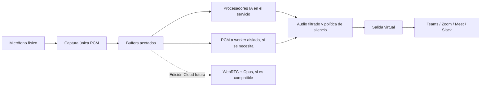

# Audio PCM y detección de voz

Decisión actual confirmada: HTTP/SSE para control Local y Cloud; PCM local; WebRTC + Opus candidato para audio remoto. gRPC únicamente cuando un adaptador lo necesite. La propuesta previa de gRPC como transporte general queda sustituida.

## Responsabilidades

CoreAudio (posiblemente mediante CPAL) captura el micrófono una sola vez por sesión. El servicio distribuye sus bloques a consumidores independientes. El transporte de control no captura, remuestrea, comprime, reconoce voz ni crea un micrófono virtual.

Detectar actividad de voz, reconocer al hablante registrado y transcribir son funciones diferentes. El alcance actual incluye detección/paso de voz personal experimental, no transcripción. La detección de que otra aplicación abrió el dispositivo virtual es también independiente de estas IA.

El diagrama representa destinos posibles; no habilita un envío remoto simultáneo en Local. El plan de sesión selecciona una ruta de procesamiento y combina resultados explícitamente. No se mezclan arbitrariamente las salidas de dos filtros ni se reproducen dos veces los mismos bloques.

## Local

- React envía comandos y consulta mediante HTTP al BFF local; recibe estados por SSE. No transporta PCM.
- Tauri supervisa el mismo ejecutable en modo servicio; el canal padre-hijo sirve para arranque y cierre.
- Los módulos usan llamadas a puertos, inbox de control y buffers acotados; no se serializa cada llamada interna.
- RNNoise corre en Rust. nomo-pvad usa un worker Python privado con PCM binario por pipes; no introduce un servidor ni gRPC.
- CoreAudio entrega el resultado a BlackHole 2ch. Las aplicaciones receptoras seleccionan esa entrada virtual.

## Contratos de sesión propuestos

| Operación      | Semántica                                                                                                               |
| -------------- | ----------------------------------------------------------------------------------------------------------------------- |
| `OpenSession`  | Validar perfil, ruta, formatos admitidos y límites; devolver identificador y negociación.                               |
| `ProcessAudio` | Streaming bidireccional cuando el audio cruza a un worker/BFF/API; no transportar el PCM por el host si no lo necesita. |
| `WatchSession` | Stream de estado, detección, métricas y errores; suscripción independiente del audio.                                   |
| `SetMute`      | Orden idempotente con ámbito y generación de sesión; acuse tras aplicar el corte local y descartar buffers afectados.   |
| `CloseSession` | Cancelación coordinada, liberación de recursos y terminación de streams.                                                |

Los nombres son propuestas, no APIs implementadas. Envelope de audio: `sessionId`, `streamId`, número de secuencia, generación/epoch, timestamp monotónico de captura, número de muestras por canal, frecuencia, canales, representación y bytes. Especificar endian e intercalado. Negociar PCM float32 o PCM16 según el adaptador; no reinterpretar formatos silenciosamente.

Relojes monotónicos solo son comparables dentro de su origen. En remoto, usar secuencias y duraciones para reconstruir continuidad y medir latencias por tramo; no restar directamente relojes de equipos distintos. Reportar discontinuidades y no tratar el silencio como paquete perdido.

Bloques iniciales candidatos de 10–20 ms, ajustados al dispositivo y modelo durante el spike. El adaptador personal acumula los 160 ms requeridos por nomo-pvad sin imponer esa granularidad a todas las salidas. Downmix/remuestreo solo en las fronteras necesarias, conservando estado entre bloques. Resolver drift entre captura y salida con ocupación de buffer y adaptación medida, no acumulando una cola indefinida.

## Consumidores lentos y silencio

Captura → ring buffer preasignado → workers. No ejecutar red, disco, inferencia, espera de locks ni serialización en el callback. Cada destino tiene cola limitada por duración y memoria; su sobrecarga no bloquea captura ni otros destinos. Para tiempo real, descartar bloques obsoletos con discontinuidad explícita y reinicio de estado del adaptador cuando lo requiera, o cerrar el consumidor con error; nunca dejar crecer la cola. La política concreta se negocia por destino y se prueba.

El control de flujo de un transporte externo no sustituye estos límites. Una escritura aceptada puede seguir pendiente en buffers del transporte. Mantener cancelación, límites de tamaño, timeout de inicio y detección de inactividad; no imponer un deadline corto que corte una llamada válida de larga duración.

Mute por defecto de producto: silenciar todas las salidas de la sesión controlada, invalidar la generación, descartar buffers pendientes y no producir respuestas de una generación anterior al reactivar. Si una salida virtual necesita continuidad, emitir ceros. Detener captura es una acción distinta que cierra el dispositivo. Mute por destino, si se añade, debe identificarse en la UI.

En una ruta remota, el corte local ocurre inmediatamente y se cancela/invalida el stream; el receptor descarta generaciones viejas. Los datos ya enviados no pueden retirarse de la red ni del servidor. No prometer «ningún audio transmitido después de pulsar» basándose solo en una cola vacía. Reanudar abre una generación nueva y nunca reproduce ni reenvía el audio acumulado durante el mute.

## Detección y respuesta de IA

Cada adaptador declara formatos, streaming/lotes, segmentación, latencia esperada como estimación, respuesta (`audio`, `voice-activity`, `target-speaker-probability` o futura `text`), límites y cancelación. Los resultados se correlacionan con secuencias/rangos del audio de entrada.

El perfil de voz se registra localmente. El módulo `personal-voice` decide abrir/cerrar el paso a partir de probabilidades; debe evitar perder principios/finales de palabras mediante una política acotada y medible. Detectar al hablante no separa dos voces simultáneas. No interpretar callbacks de transporte o consumo del micrófono como detección de voz.

Si una IA futura produce audio de respuesta, requerirá una ruta de reproducción diferente y prevención de realimentación/eco. La beta de filtros no añade por defecto un asistente que habla ni reproduce el micrófono por altavoces.

## Cloud futura

Control: cliente → HTTP → BFF → módulos, con resultados por SSE. Para audio remoto se evaluará WebRTC + Opus cuando lo soporten la capacidad y el servidor; señalización, STUN/TURN y adaptación de códec requerirán diseño y pruebas. Si un proveedor exige gRPC u otro protocolo, su adaptador lo implementará sin filtrar formatos de SDK al dominio.

No comprimir trayectos locales. Decodificar/remuestrear únicamente en las fronteras necesarias. Cloud sigue fuera de esta implementación.

## Pruebas y referencias

Probar formatos, partición en bloques, remuestreo continuo, drift, consumidores lentos, memoria máxima, caída/reinicio de workers, permisos del socket, incompatibilidad de protocolo, cancelación y mute con datos en vuelo. Medir por separado captura, colas, procesamiento, transporte e inferencia. Tests de contrato no acreditan un micrófono o modelo real.

- [gRPC: streaming y ciclo de vida](https://grpc.io/docs/what-is-grpc/core-concepts/).
- [Control de flujo](https://grpc.io/docs/guides/flow-control/).
- [Cancelación](https://grpc.io/docs/guides/cancellation/).
- [Deadlines](https://grpc.io/docs/guides/deadlines/).
- [Tonic y transporte UDS](https://docs.rs/tonic/latest/tonic/transport/server/index.html).
- [Tonic](https://github.com/hyperium/tonic), [Prost](https://github.com/tokio-rs/prost).

## Implementación de desarrollo

48 kHz float32, entrada mono/estéreo, downmix a mono; RNNoise usa bloques de 480 muestras (10 ms) con conversión de escala dentro del adaptador. El callback solo copia PCM a un ring preasignado. El trabajador realiza inferencia y la salida duplica mono a los canales de BlackHole.

Voz personal acumula 16 bloques y remuestrea a 16 kHz con FIR de 63 taps; nomo-pvad recibe 2560 muestras (160 ms). Umbral inicial fijo 0,7, experimental, sin calibración ni garantía de aislamiento. El audio filtrado se libera o silencia por bloque según la probabilidad. Falta suavizado/histéresis calibrado: no presentarlo como calidad de producción.

Rings de 32 bloques por sentido, capacidad de 320 ms. Sobrecarga o pérdida de dispositivo termina la sesión y silencia salida, no acumula audio indefinidamente. No hay todavía compensación continua de drift entre relojes; es una limitación para llamadas largas. Cancelar detiene la sesión; no equivale a un mute reversible. Descartar el estado de la sesión evita reproducir audio antiguo al iniciar otra.
